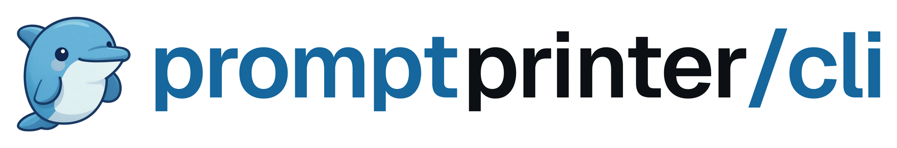

<div align="center">



</div>

# PromptPrinter in your terminal

Tell Finn what you want, answer one short question, get one finished prompt that works in any AI. This is the terminal client of [PromptPrinter](https://promptprinter.app): the same account, the same Finn, your conversations also show up in the browser.

> **Status: in development, not on npm yet.** Sign-in, chat and `/pp --kontext` (local project context, sent only after a preview) work.

```text
> /pp landing page for a hairdresser
Finn: Two quick things: who reads it, and what tone do you want?
> people from the neighbourhood, casual
Finn: Here is your prompt.
┌─ Prompt ─────────────────────────────────────────────
│ ...
└──────────────────────────────────────────────────────
/copy copy   /save save   /an claude or codex   /pp new prompt
```

## Run it from source

Needs Node 22 or newer. No dependencies.

```bash
git clone https://github.com/BajKasum/promptprinter-cli.git
cd promptprinter-cli
node bin/promptprinter.mjs
```

On first start the program shows a code. Open the address it shows, sign in if needed, type the code and confirm. There is no password in the terminal.

A Free account chats with its own AI key, which you add once [in the browser](https://promptprinter.app/settings). The terminal never sees that key.

## Install

There is no npm package yet. Until this line changes, a package called `promptprinter` on npm is not from this project.

<!-- Ab der ersten Veröffentlichung sichtbar machen und den Satz oben ersetzen (CLAUDE.md, "Veröffentlichung"):

Needs Node 22 or newer.

```bash
npm install -g promptprinter
promptprinter
```

Try it without installing: `npx promptprinter`. Update with `npm install -g promptprinter@latest`. To remove it, first `promptprinter logout`, then `npm uninstall -g promptprinter`.

From the second version on, each one is published from GitHub Actions with [provenance](https://docs.npmjs.com/generating-provenance-statements): the npm page names the commit and the workflow it was built from.
-->

## Commands

| In the program | |
|---|---|
| `/pp <idea>` | new prompt: Finn asks briefly, then prints it |
| `/pp --kontext <idea>` | the same, with context from the current folder: shows the whole message first and sends it only after you type `j` (`y` in English) |
| `/new` | new conversation |
| `/copy` | copy the latest prompt |
| `/save [file]` | save the latest prompt as Markdown, never overwrites |
| `/an claude`, `/an codex` | start Claude Code or Codex right here with the latest prompt as the first message; back to PromptPrinter when you quit it |
| `/whoami` | show account, plan and key |
| `/login`, `/logout` | sign in, sign this device out |
| `/help`, `/exit` | |

`/an` needs the agent installed (`claude` or `codex` on your `PATH`). It never goes through a shell: the prompt is handed over as one argument, so quotes, `&`, `|` or `%` in it stay text. On Windows the `.cmd` file that npm installs is resolved to the script it starts; an unknown kind of wrapper is not started, `/copy` is the way then.

Anything else you type goes to Finn. `Ctrl+C` stops a running reply; at the empty prompt it quits.

From the shell: `promptprinter login`, `logout`, `whoami`, `mcp`, `--version`, `--help`.

## MCP: PromptPrinter inside Claude Code, Claude Desktop and other MCP clients

`promptprinter mcp` is an MCP server over stdio. It has three tools:

| Tool | |
|---|---|
| `create_prompt` | sends an idea to Finn; returns Finn's question or the finished prompt, with a `conversation_id` to answer the question |
| `list_saved_prompts` | your saved prompts, newest first; optional `query` and `limit` (1 to 50) |
| `get_saved_prompt` | one saved prompt by `id` |

It never signs in by itself: run `promptprinter` once in a terminal and sign in, the MCP server then uses that sign-in (and renews it). Without it, every tool answers "run `promptprinter` once and sign in". Conversations started through MCP are stored in your account like any chat.

From source, register it with the full path to this folder:

```bash
claude mcp add promptprinter -- node /path/to/promptprinter-cli/bin/promptprinter.mjs mcp
```

<!-- Ab der ersten Veröffentlichung sichtbar machen und den Satz "From source" samt Befehl oben ersetzen (CLAUDE.md, "Veröffentlichung"):

Claude Code:

```bash
claude mcp add promptprinter -- npx -y promptprinter mcp
```

Claude Desktop, in `claude_desktop_config.json`:

```json
{"mcpServers":{"promptprinter":{"command":"npx","args":["-y","promptprinter","mcp"]}}}
```
-->

The server speaks MCP `2026-07-28` (per-request metadata, `server/discover`) and, for clients that still start with `initialize`, `2025-11-25`, `2025-06-18` and `2025-03-26`. stdout carries only protocol messages.

## What it stores and sends

- **On your computer:** one file, `session.json`, in `%APPDATA%\promptprinter` (Windows) or `~/.config/promptprinter`. It holds your sign-in and is readable only by you on Linux and macOS (`0600`); on Windows only your own account has access to its folder (no inherited permissions). Anyone who can read this file can act as you until the session is revoked. It holds no AI provider key.
- **To PromptPrinter:** your computer's name when signing in (shown on the confirmation page), then what you type. The server stores each conversation like any chat in the browser and sends it to the AI provider of your account. No telemetry.
- **With `/pp --kontext`, and only then:** the program reads the folder you started it in. It collects the git state (branch, changed files, diff summary, last commit subjects), project facts (dependencies, scripts, folder structure, names of rule files like `CLAUDE.md`) and up to three matching lines per file from at most ten files, searched with words from your idea. Files like `.env`, keys and credentials are named but never read. Known secret patterns (keys, tokens, passwords in URLs and assignments, private keys) are replaced by `[redacted: …]`, and the context is cut so that idea plus context stay within 8000 characters; your idea is never cut. Before anything leaves your computer you see the whole message, who receives it (PromptPrinter and your own AI provider, or Z.ai in Singapore through the server key) and that it stays in your chat history. Only `j` sends; anything else, `Ctrl+C` or input from a pipe sends nothing. Once sent, the context is part of the conversation like any message: visible in the browser and sent to the model again with later messages of that conversation. Redaction catches known patterns, not every secret, so read the preview.
- `promptprinter logout` ends this one session. Signing out in the browser ends all of them.

## Settings

| Variable | |
|---|---|
| `NO_COLOR` | no colours |
| `PROMPTPRINTER_LANG` | `de` or `en`, otherwise taken from your system |
| `PROMPTPRINTER_NO_BROWSER` | do not open the browser when signing in |
| `PROMPTPRINTER_CONFIG_DIR` | another folder for the sign-in file |
| `PROMPTPRINTER_URL` | another server, `https` only (`http` only on this computer); a sign-in is never sent to another server |

## Development

```bash
npm test          # tests against a local stub server
npm run check     # syntax
npm run mutation  # breaks each safeguard, the tests must notice
npm run contract  # compares the server's interface with the pinned version
```

The real program against a local server, confirmed in the browser, needs the main repository and runs outside `npm test`: [acceptance/README.md](acceptance/README.md).

MIT, see [LICENSE](LICENSE). Security reports: [SECURITY.md](SECURITY.md).
